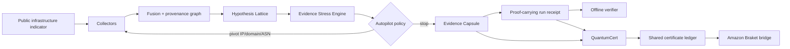
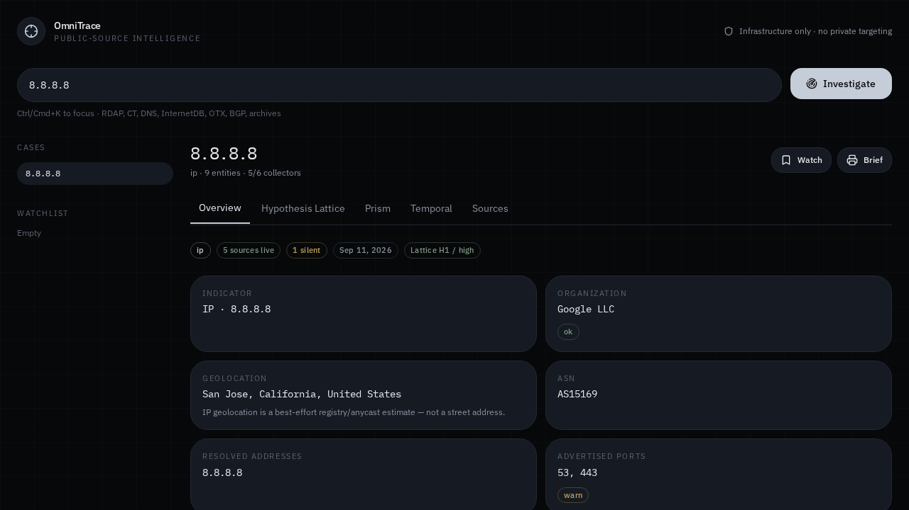
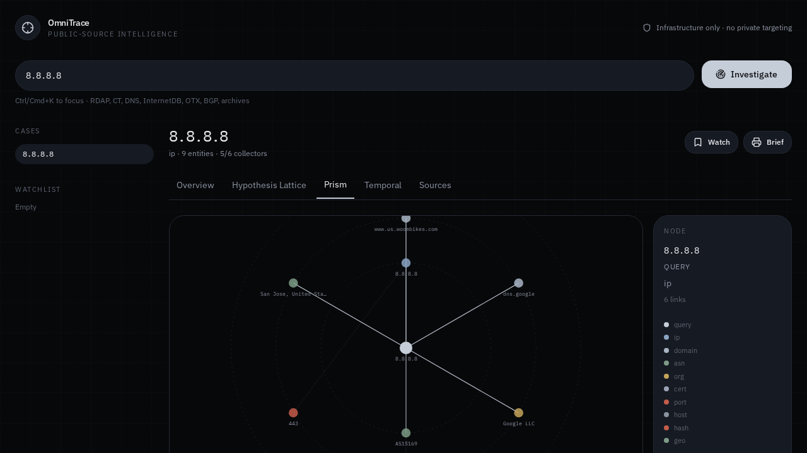

# Omni

<p align="center">
  <strong>Proof-carrying investigation, evidence robustness, and quantum/classical attestation in one research workspace.</strong>
</p>

<p align="center">
  <a href="https://github.com/aixaria0/Omni/actions/workflows/ci.yml"></a>
  
  
  
  
</p>

Omni is a multi-surface research system built around one principle: **important analytical conclusions should carry enough structure to be challenged, replayed, and verified**.

The repository contains two connected product planes:

- **OmniTrace** — public-source infrastructure collection, hypothesis analysis, adversarial evidence stress-testing, deterministic autonomous pivots, and portable proof-carrying run receipts.
- **Quantum Fabric** — browser-local quantum simulation, hybrid certificates, a shared attestation ledger, and an Amazon Braket Hybrid Jobs bridge for managed simulator or QPU execution.

> Omni's integrity mechanisms prove identity, consistency, and binding of recorded evidence and reasoning state. They do **not** turn public-source claims into ground truth.

## Why Omni is different

| Capability                 | What it does                                                                                                                                                |
| -------------------------- | ----------------------------------------------------------------------------------------------------------------------------------------------------------- |
| **Hypothesis Lattice**     | Scores competing explanations against an explicit evidence matrix instead of collapsing immediately to one narrative.                                       |
| **Evidence Stress Engine** | Finds fragile conclusions, minimal evidence-removal flip sets, source concentration, Shapley-style evidence leverage, and adversarial robustness frontiers. |
| **Autopilot**              | Runs a bounded closed loop over public infrastructure: observe → stress → plan → collect pivot → fuse → repeat/stop.                                        |
| **Evidence Capsules**      | Creates portable, section-hashed snapshots with separate semantic and observation identities.                                                               |
| **Proof-carrying runs**    | Hash-chains autonomous rounds and replays capsule integrity, Stress state, and deterministic planner decisions during verification.                         |
| **QuantumCert**            | Binds evidence or run roots to quantum witness output, a 3-of-4 Ed25519 quorum, and SHA3-512 integrity checks.                                              |
| **Braket bridge**          | Runs the same variational Hybrid Job locally, on SV1/DM1, or on a runtime-selected QPU ARN.                                                                 |

## System at a glance



The autonomous boundary is deliberately narrow: **Autopilot only expands through public IP, domain, and ASN entities already represented in the case graph.** It does not autonomously pivot to people or attempt deanonymization.

## Product surfaces

### OmniTrace

The main workspace (`/`) combines:

- parallel public-source collectors such as DNS, RDAP, Certificate Transparency, Wayback, urlscan.io, AlienVault OTX, Shodan InternetDB, BGPView, RIPE Stat, and selected public metadata sources;
- a fused fact set and provenance graph;
- an Analysis of Competing Hypotheses-style lattice;
- **Stress Lab** for counterfactual robustness and source-knockout analysis;
- **Autopilot** for bounded self-driving infrastructure investigation;
- **Evidence Capsule** sealing, verification, import/export, and semantic drift detection.

### Quantum Fabric

The `/quantum` surface contains three distinct trust boundaries:

1. **12-qubit statevector register** — a browser-local simulator with GHZ/zero initialization, H/X/RY/CNOT gates, Born-rule measurement, Pauli expectations, and global GHZ coherence checks.
2. **QuantumCert** — Bell/shadow/GHZ witness paths combined with 4 fresh Ed25519 validators (`f=1`, threshold `3/4`) and SHA3-512 binding.
3. **Amazon Braket bridge** — an independent Python Hybrid Jobs runner for local simulation, SV1, DM1, or a QPU ARN supplied at runtime.

A browser simulator is never represented as physical quantum hardware. Managed hardware/simulator evidence belongs to the Braket execution path.

## Interface

<p align="center">
  
  
</p>

<p align="center"><sub>Representative OmniTrace captures: fused investigation overview and graph-centric Prism view.</sub></p>

## Quick start

### Requirements

- Node.js **22+**
- npm

```bash
git clone https://github.com/aixaria0/Omni.git
cd Omni
npm ci
npm run dev
```

The application starts through the repository's environment wrapper and serves the TanStack/React workspace on the configured development endpoint.

### Validate the repository

```bash
npm run typecheck
npm run lint
npm run test:core
npm run build:dev
```

`npm run test:platform` runs the inherited platform-template test suite separately. See [Development](docs/DEVELOPMENT.md) for the complete validation model.

## Verify an Autopilot proof outside the UI

Exported autonomous runs use the `.autopilot.json` receipt format. Verification recomputes capsule integrity, the round hash chain, Stress checkpoints, planner decisions, and the final run root.

```bash
npm run verify:autopilot -- path/to/run.autopilot.json
```

A valid receipt proves self-consistency relative to its `runRoot`. External authenticity still depends on preserving or independently attesting that root.

## Documentation

| Document                                 | Purpose                                                                               |
| ---------------------------------------- | ------------------------------------------------------------------------------------- |
| [Documentation index](docs/README.md)    | Start here for the complete technical map.                                            |
| [Architecture](docs/ARCHITECTURE.md)     | Components, data flow, trust boundaries, and runtime model.                           |
| [Collectors](docs/COLLECTORS.md)         | Query classification, public-source matrix, failure behavior, and operational bounds. |
| [Evidence model](docs/EVIDENCE_MODEL.md) | Capsules, dual digests, provenance identity, drift, and integrity semantics.          |
| [Stress Engine](docs/STRESS_ENGINE.md)   | Counterfactual model, flip sets, Shapley attribution, and robustness frontier.        |
| [Autopilot](docs/AUTOPILOT.md)           | Planner policy, proof-carrying rounds, stop conditions, and portable verification.    |
| [Quantum Fabric](docs/QUANTUM_FABRIC.md) | Statevector engine, QuantumCert, and trust limits.                                    |
| [Development](docs/DEVELOPMENT.md)       | Local setup, scripts, testing, CI, and repository conventions.                        |
| [Security model](SECURITY.md)            | Responsible-use boundary, secrets, reporting, and cryptographic scope.                |
| [Amazon Braket](braket/README.md)        | Hybrid Jobs setup and backend selection.                                              |

## Repository layout

```text
Omni/
├── src/
│   ├── components/osint/       # OmniTrace surfaces
│   ├── components/quantum/     # Quantum Fabric surfaces
│   ├── lib/osint/              # collection fusion, capsules, stress, autopilot
│   ├── lib/quantum/            # statevector, SHA3-512, certificates
│   └── routes/                 # TanStack routes
├── scripts/                    # repository/platform tooling + proof verifier
├── braket/                     # independent Amazon Braket Hybrid Jobs bridge
├── docs/                       # architecture and subsystem documentation
├── screenshots/                # captured UI/reference assets
└── .github/workflows/ci.yml    # validation pipeline
```

## Design constraints

Omni intentionally preserves several boundaries that are easy to blur in research tooling:

- **robustness ≠ truth** — Stress scores measure decision sensitivity under the implemented counterfactual model;
- **integrity ≠ provenance authority** — a valid capsule proves the supplied artifact was not modified relative to its digest, not that a source statement is true;
- **quorum self-consistency ≠ external validator identity** — browser QuantumCert validators are fresh ephemeral Ed25519 identities;
- **simulation ≠ hardware evidence** — physical or managed-device claims require Braket job identity and logs;
- **public infrastructure ≠ people targeting** — Autopilot expansion is restricted to IP/domain/ASN infrastructure;
- **stored browser state ≠ immutable transparency log** — local persistence can be deleted or rolled back by someone controlling the browser profile.

More detail is in [Architecture](docs/ARCHITECTURE.md) and [Security model](SECURITY.md).

## Contributing

Changes should preserve deterministic verification paths, explicit trust boundaries, and testable claims. Read [CONTRIBUTING.md](CONTRIBUTING.md) before opening a pull request.

## Project status

Omni is under active development. Interfaces and artifact schemas are versioned where portability matters (`omnitrace.evidence-capsule`, `omnitrace.autopilot-receipt`), but application APIs may continue to evolve.
