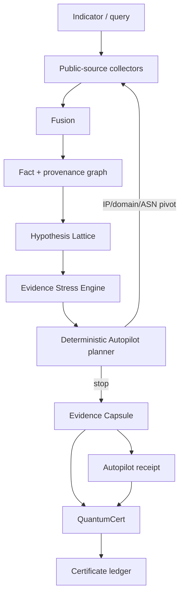

# Architecture

Omni is one TanStack/React application with two connected product planes: **OmniTrace** and **Quantum Fabric**. They share the same shell and local persistence, but their trust claims remain separate.

## High-level data flow



## Runtime layers

### 1. Collection

`src/lib/osint/collect.server.ts` performs public-source collection. Collector availability depends on the query kind. The current set includes DNS, RDAP, Certificate Transparency, Wayback CDX, urlscan.io, AlienVault OTX, HTTP fingerprinting, ipwho.is, Shodan InternetDB, BGPView, RIPE Stat, GitHub public profile metadata, and Wikipedia summary data where applicable.

Collection results retain:

- collector id and display name;
- success/failure status;
- latency;
- parsed response data when available;
- an error message when collection fails.

The collector layer is not a trust oracle. It supplies observations for later fusion and comparison.

### 2. Fusion and provenance

`src/lib/osint/fuse.ts` converts heterogeneous collector responses into:

- normalized facts;
- graph nodes and edges;
- timeline events;
- explicit disagreements.

Fact and graph-edge identities are content-addressed. This is important for semantic stability: equivalent evidence should not become different merely because a random id changed between runs.

### 3. Hypothesis Lattice

The active `LatticeResult` contains:

- competing hypotheses;
- prior/posterior weights;
- an evidence matrix using `support`, `contradict`, `neutral`, or `na` cells;
- a leading hypothesis and confidence label;
- unresolved gaps and watch requirements.

Omni can use its local heuristic lattice and can also hold a model-produced lattice. Downstream Stress calculations identify the engine and do not present model counterfactuals as model re-runs.

### 4. Evidence Stress Engine

`src/lib/osint/stress.ts` treats the active lattice as a decision state and evaluates how fragile that state is under evidence removal.

Outputs include:

- leave-one-evidence-out impact;
- minimal flip set;
- source knockout;
- Shapley-style coalitional contribution;
- adversarial robustness frontier;
- dominant-source concentration;
- next-best collection priorities.

See [Stress Engine](STRESS_ENGINE.md).

### 5. Autopilot

`src/lib/osint/autopilot.ts` closes the loop. It consumes the current investigation and Stress report, chooses a bounded next action, collects a public infrastructure pivot, merges that observation into the world model, and decides whether to continue.

Autonomous pivots are restricted to:

- IP;
- domain;
- ASN.

Each round is executed as a separate collection request rather than one long-running serverless request. This makes progress visible and isolates a failed pivot from the rest of the trace.

See [Autopilot](AUTOPILOT.md).

### 6. Evidence Capsules

`src/lib/osint/capsule.ts` serializes an investigation into a portable integrity artifact. The design uses two top-level identities:

- `evidenceDigest` for semantic evidence identity;
- `rootDigest` for the concrete observation identity.

Section digests bind sources, facts, graph, timeline, lattice, and disagreement state.

See [Evidence model](EVIDENCE_MODEL.md).

### 7. Proof-carrying Autopilot receipts

An Autopilot receipt stores ordered rounds. Every round binds:

- action that produced the state;
- next planner decision;
- complete Evidence Capsule;
- Stress checkpoint and digest;
- previous round root;
- current round root.

The final `runRoot` binds policy, ordered rounds, final evidence state, and stop reason. Verification replays deterministic planner decisions rather than only checking opaque hashes.

### 8. Quantum Fabric

Quantum Fabric is a separate verification surface containing:

- browser-local statevector simulation;
- Bell/shadow/GHZ witness calculations;
- 4-node Ed25519 quorum records with threshold 3/4;
- SHA3-512 binding;
- a shared certificate ledger;
- an independent Amazon Braket Python bridge.

Evidence Capsule roots and Autopilot run roots can be bound as typed certificate subjects.

See [Quantum Fabric](QUANTUM_FABRIC.md).

## Persistence model

Omni uses Zustand persistence for local application state.

Persisted OmniTrace state includes investigation history, watchlist state, Evidence Capsules, and Autopilot receipts. Historical investigation entries intentionally strip raw collector response bodies before persistence. Capsules retain normalized source manifests and data digests rather than raw response bodies.

Quantum certificates are persisted in a separate shared certificate store.

### Important limitation

Browser-local persistence is not an append-only transparency service. A user or attacker controlling the browser profile can delete or roll back local state. Artifact hashes detect mutation of a supplied artifact; they do not prove that an older artifact was not removed.

## Deployment model

The web application builds through Vite/TanStack Start/Nitro and targets Vercel. CI uses Node 22 and a synchronized npm lockfile.

The Amazon Braket bridge is intentionally separate from the browser application. Managed Braket execution uses AWS credentials from the normal SDK credential chain and no AWS secrets are committed to this repository.

## Trust boundaries

| Boundary                 | Omni can establish                                           | Omni does not establish                                           |
| ------------------------ | ------------------------------------------------------------ | ----------------------------------------------------------------- |
| Collector response       | What was processed in a specific run                         | That the remote source was correct                                |
| Evidence Capsule         | Integrity and semantic/concrete artifact identity            | Ground truth or immutable publication history                     |
| Stress Engine            | Sensitivity under the implemented counterfactual model       | General statistical truth or causal certainty                     |
| Autopilot receipt        | Self-consistent ordered trace + deterministic planner replay | Independent external authenticity unless the run root is anchored |
| QuantumCert              | Witness/quorum/binding self-consistency                      | Stable external validator identities                              |
| Browser quantum register | Correctness of implemented simulation/tests                  | Physical quantum hardware execution                               |
| Braket bridge            | Managed/local job identity and result path                   | Correctness of an external scientific claim by itself             |

## Key implementation directories

```text
src/lib/osint/             investigation data plane
src/components/osint/      OmniTrace UI surfaces
src/lib/quantum/           simulation, SHA3-512, certificates
src/components/quantum/    Quantum Fabric UI
src/routes/                application routes
scripts/                   development/platform tooling + proof verifier
braket/                    Python Hybrid Jobs bridge
```
