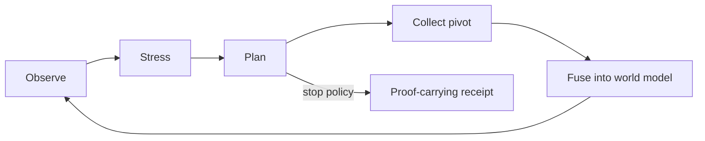

# Autopilot

Autopilot is OmniTrace's bounded self-driving investigation runtime. It turns Stress Engine output into deterministic collection actions over public infrastructure while preserving an auditable proof of every round.

## Closed loop



Autopilot does not ask a model to invent arbitrary next steps. The planner operates over explicit case state and a narrow pivot policy.

## Autonomous boundary

Autonomous pivot targets are restricted to graph entities of these kinds:

```text
ip
domain
asn
```

No person-oriented entity type is eligible for autonomous expansion. The runtime is designed for public infrastructure investigation, not deanonymization.

## Policy

Current default policy:

```text
maxRounds            = 4
targetStability      = 82
targetMargin         = 0.20
minimumLiveCoverage  = 0.72
```

Policy sanitation constrains custom values to implementation-defined safe ranges. The default planner can stop for three reasons:

- `robustness-target-reached`
- `no-actionable-infrastructure-pivots`
- `round-budget-exhausted`

## Action types

`AutopilotAction` supports:

- `seed` — initial observation;
- `pivot` — autonomous IP/domain/ASN expansion;
- `refresh-root` — collect the root subject again when appropriate;
- `stop` — terminate with a typed stop reason.

Every action records the target, target kind, reason, expected information gain, and estimated cost. Pivots also carry a planner score.

## Planner inputs

The deterministic planner evaluates current case state including:

- Stress Engine stability and decision margin;
- unresolved collection priorities;
- dominant-source concentration;
- graph candidates and their risk/hop context;
- already executed actions;
- live collector coverage;
- round budget and robustness policy.

A target is not selected merely because it exists in the graph. The planner scores eligible infrastructure pivots and avoids repeating the same action key.

## World-model fusion

A pivot collection remains its own concrete investigation, but its evidence is folded back into the root case world model.

Provenance from pivot observations is namespaced before merge so facts, source records, nodes, edges, and timeline events remain attributable to the observation that produced them.

The fused world model then receives a fresh heuristic lattice and Stress report. The next planner decision is made from that updated state.

## One request per round

The UI executes collector rounds individually rather than wrapping the complete loop in one long server request.

This provides four operational benefits:

1. progress is visible between rounds;
2. one slow or failed pivot does not erase the previous trace;
3. the runtime is less dependent on a long serverless execution window;
4. each observation is a distinct evidence state that can be sealed and verified.

## Proof-carrying rounds

Every `AutopilotRound` contains:

```text
index
action
nextAction
capsule
checkpoint
stressDigest
previousRoundRoot
roundRoot
```

The checkpoint is a compact decision state containing the leader, runner-up, margin, entropy, stability score, grade, minimal flip size, dominant source, source concentration, and top collection priority.

The complete Stress report is deterministically recomputed during verification; `stressDigest` binds the report that produced the checkpoint.

## Round chaining

Each round root binds the previous round root and the current proof material. This creates an ordered SHA3-512 chain rather than a bag of independent snapshots.

The round chain also binds capsule sealing metadata that is intentionally outside the capsule's semantic evidence identity. This prevents run-history metadata from being changed silently while leaving the embedded capsule evidence root intact.

## Final receipt

Current schema:

```text
schema  = omnitrace.autopilot-receipt
version = 1
```

The receipt binds:

- root query and kind;
- run start/completion metadata;
- sanitized policy;
- ordered rounds;
- stop reason;
- final investigation/evidence/capsule identity;
- final leader and stability score;
- `runRoot`.

## Verification

`verifyAutopilotReceipt` does more than compare stored hashes. It checks:

1. every embedded Evidence Capsule;
2. Stress report/checkpoint consistency;
3. previous-round continuity;
4. each round root;
5. deterministic planner replay for the recorded state;
6. final evidence state;
7. final `runRoot`.

If any of these checks fail, the receipt is invalid and reports verification problems.

## Portable verification

Exported receipts can be verified without the UI:

```bash
npm run verify:autopilot -- path/to/run.autopilot.json
```

The parser rejects unsupported/malformed receipts and requires a successful full verification before accepting the artifact.

## QuantumCert binding

A final Autopilot `runRoot` can be sent to QuantumCert with subject kind:

```text
autopilot-run
```

That binds the exact run root into the QuantumCert proposal and hybrid digest. The resulting certificate is stored in the shared Quantum Fabric certificate ledger.

This creates a bridge between two layers:

```text
Autopilot proof
  └─ deterministic investigation trace integrity

QuantumCert
  └─ witness + quorum + digest binding of the trace root
```

It does not make the underlying public-source claims true.

## Failure and limitation model

Autopilot is intentionally bounded. Important limitations include:

- planner quality is limited by the case graph and Stress model presented to it;
- unavailable collectors can reduce live coverage and constrain useful pivots;
- a valid receipt proves self-consistency relative to its `runRoot`, not independent publication time or external authorship;
- local receipt persistence can be deleted by someone controlling the browser profile;
- the runtime does not perform active exploitation or private-person targeting.

For the counterfactual model that feeds the planner, see [Stress Engine](STRESS_ENGINE.md). For artifact identity and digest semantics, see [Evidence model](EVIDENCE_MODEL.md).
