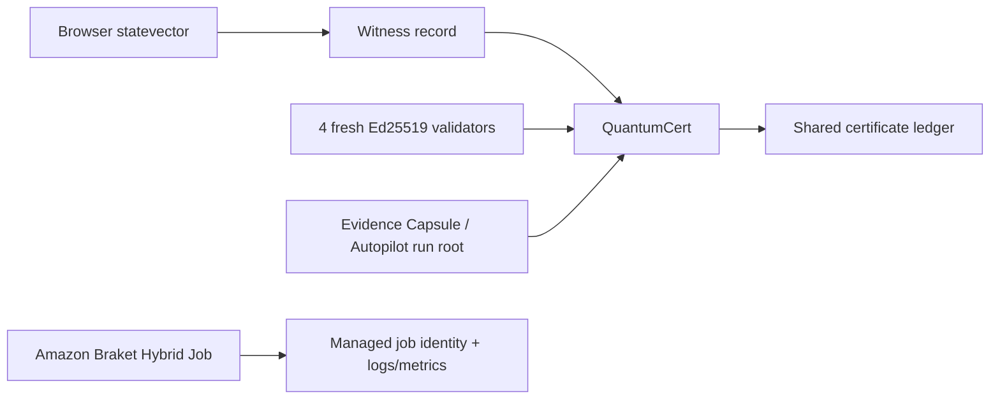

# Quantum Fabric

Quantum Fabric is Omni's verification and quantum-experiment surface. It intentionally separates browser simulation, hybrid certificate logic, and managed Amazon Braket execution.

## Trust boundaries



The browser statevector and Amazon Braket bridge are not interchangeable evidence sources. Browser simulation is local simulation. Managed Braket runs have their own job identity and telemetry.

## 12-qubit statevector engine

`src/lib/quantum/register.ts` implements a browser-local statevector register.

For 12 qubits the state has:

```text
2^12 = 4096 complex amplitudes
```

The implementation stores real and imaginary components in `Float64` arrays and supports:

- all-zero initialization;
- GHZ initialization;
- H gate;
- X gate;
- RY rotation;
- CNOT;
- Born-rule measurement with collapse;
- Z expectation;
- ZZ expectation;
- XX/YY expectations used by witness logic;
- generic Pauli expectation support;
- global X-tensor coherence for GHZ analysis.

The command layer in `src/lib/quantum/commands.ts` provides a natural-language/command interface over the same persisted register instance.

## GHZ semantics

The UI and tests distinguish correlation from entanglement claims.

Pairwise `ZZ` correlation in a GHZ state is not presented as proof of pairwise entanglement. Multipartite GHZ handling uses global X coherence as the relevant signature in the implemented scenario.

## QuantumCert

`src/lib/quantum/cert.ts` builds a `HybridCertificate` from three independent checks.

### 1. Quantum evidence

Available witness paths:

- `bell-pauli`
- `classical-shadow`
- `ghz-coherence`

The Bell witness is:

```text
W = (1 - XX + YY - ZZ) / 4
```

The implemented Bell state produces `-0.5` and passes the negative-witness policy. A chosen separable scenario produces a non-negative witness and is rejected.

### 2. Classical quorum

Each certificate run generates four fresh WebCrypto Ed25519 keypairs.

```text
total validators = 4
fault model       = f = 1
threshold         = 3 / 4
```

Votes store node id, raw public key, signature, and verification result. The Byzantine scenario deliberately introduces one equivocation and still passes when three signatures verify.

These validators are ephemeral identities created for the certificate run. The certificate proves self-consistency of that quorum record; it does not establish those keys as independently governed external validator identities.

### 3. SHA3-512 binding

QuantumCert computes:

- `quantumDigest` from witness material;
- `proposalDigest` from scenario, quantum digest, and optional typed subject;
- a quorum digest over the proposal and verified signatures;
- a final binding digest over quorum + quantum material and, when present, the bound subject digest.

The SHA3-512 implementation has regression tests including the FIPS 202 empty-string vector.

## Typed bound subjects

Current subject kinds:

```text
evidence-capsule
autopilot-run
```

A subject includes:

- kind;
- display label;
- 512-bit hexadecimal digest.

Bound subjects are included in the proposal digest and final hybrid binding, so changing the subject changes the certificate identity.

## Built-in scenarios

| Scenario    | Purpose                          | Expected policy outcome        |
| ----------- | -------------------------------- | ------------------------------ |
| `bell`      | entangled Bell state             | accepted                       |
| `separable` | non-entangled comparison         | rejected                       |
| `tamper`    | mutate final binding             | rejected                       |
| `byzantine` | one equivocal validator          | accepted with 3/4 valid quorum |
| `shadow`    | randomized Pauli shadow estimate | uncertainty-aware              |
| `ghz`       | multipartite GHZ coherence       | global coherence path          |

## Classical-shadow path

The current shadow scenario uses:

```text
snapshots  = 300
groups     = 10
group size = 30
visibility = 0.92
```

Randomized Pauli outcomes are summarized with a median-of-means style estimator. The certificate records uncertainty and only passes the configured negative-witness margin when the estimate remains below zero beyond the implemented uncertainty rule.

## Certificate ledger

Quantum certificates are persisted through `src/lib/quantum/store.ts` in a shared local ledger. Certificates created from the Quantum Fabric UI and certificates created by OmniTrace bound-attestation flows appear in the same store.

As with other browser-local persistence, local ledger history can be deleted or rolled back by someone controlling the browser profile.

## Amazon Braket bridge

The `braket/` subproject is independent Python code using Amazon Braket Hybrid Jobs.

Supported backend modes:

- embedded local simulator;
- SV1;
- DM1;
- QPU ARN provided at runtime.

The bridge runs a simple variational RY ansatz, evaluates `<Z>`, computes `cost = (1 + <Z>)/2`, uses a parameter-shift gradient, and reports Hybrid Jobs metrics.

AWS credentials are not stored in the repository. Managed execution uses the normal AWS SDK credential chain.

See [Amazon Braket Hybrid Jobs](../braket/README.md) for commands and environment configuration.

## What Quantum Fabric does not claim

- Browser simulation is not proof of physical quantum execution.
- A negative Bell witness applies to the simulated/tested state and implemented witness, not to unrelated external data.
- Fresh in-browser validator keys are not a decentralized governance network.
- Binding an Evidence Capsule or Autopilot root proves the certificate refers to that digest; it does not make the underlying evidence true.
- Physical-device evidence should be tied to Braket-managed job identity/logs rather than inferred from browser certificates.
